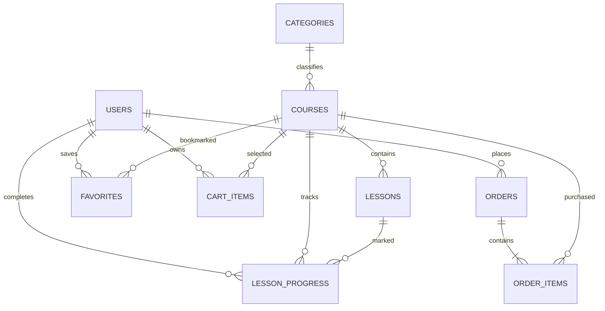

# Проектирование базы данных CourseMarket

## 1. Общие сведения

СУБД: SQLite. Управление схемой: `CourseMarketDatabase : SQLiteOpenHelper`. Доступ к данным из интерфейса отделён через `CourseMarketRepository`. Методы репозитория являются `suspend` и выполняют обращения к SQLite в `Dispatchers.IO`.

Включена проверка внешних ключей через `SQLiteDatabase.setForeignKeyConstraintsEnabled(true)`.

## 2. Таблицы

| Таблица | Ключевые поля | Назначение |
|---|---|---|
| `categories` | `id PK`, `name UNIQUE` | Справочник направлений |
| `users` | `id PK`, `username UNIQUE`, `password_hash`, `password_salt`, `role` | Клиенты и администратор |
| `courses` | `id PK`, `category_id FK`, `title`, `author`, `price`, `is_active` | Каталог курсов |
| `lessons` | `id PK`, `course_id FK`, `lesson_index`, `introduction`, `practice`, `answers_json` | Учебный материал и тест |
| `favorites` | `user_id FK`, `course_id FK`, составной PK | Избранные курсы |
| `cart_items` | `user_id FK`, `course_id FK`, `quantity` | Корзина пользователя |
| `orders` | `id PK`, `user_id FK`, `order_number UNIQUE`, `status`, `total` | Заказы |
| `order_items` | `id PK`, `order_id FK`, `course_id FK`, `quantity`, `unit_price` | Позиции заказа |
| `lesson_progress` | `user_id FK`, `course_id FK`, `lesson_id FK`, составной PK | Пройденные уроки |

## 3. ER-диаграмма

## 4. Связи и ограничения

- Одна категория содержит много курсов.
- Один курс содержит несколько уроков.
- Пользователь и курс связаны через избранное и корзину отношением многие-ко-многим.
- Один пользователь может оформлять много заказов.
- Один заказ содержит одну или несколько позиций.
- Позиция заказа ссылается на курс и хранит `unit_price`, чтобы сумма заказа не зависела от будущего изменения цены курса.
- Прогресс связан одновременно с пользователем, курсом и уроком.
- Удаление курса с существующими позициями заказа ограничено внешним ключом `RESTRICT`; уроки, избранное и прогресс могут удаляться каскадно.
- Для цены и количества заданы CHECK-ограничения.

## 5. Реализованный CRUD

| Сущность | Create | Read | Update | Delete |
|---|---|---|---|---|
| Пользователи | Регистрация | Вход/получение учётной записи | — | — |
| Курсы | Админ добавляет | Каталог/детали | Админ редактирует | Админ удаляет с учётом FK |
| Корзина | Добавить курс | Показать корзину | Количество подготовлено в схеме | Удалить позицию |
| Заказы | Создать заказ в транзакции | Профиль/админ | Статус заказа | История сохраняется |
| Избранное | Добавить | Список избранного | — | Удалить |
| Прогресс | Отметить урок | Показать прогресс | Повторная отметка без дубликата | Каскад при удалении зависимостей |

## 6. Фоновые операции

Repository использует `withContext(Dispatchers.IO)` для чтения и записи. Создание заказа выполняет вставку заказа, позиций и очистку корзины в одной транзакции `beginTransaction / setTransactionSuccessful / endTransaction`.

## 7. Версионирование

Базовая версия схемы задаётся `DATABASE_VERSION = 1`. `onCreate` создаёт таблицы, индексы и связи; `onUpgrade` вызывает идемпотентное создание отсутствующих объектов схемы. При добавлении несовместимых изменений номер версии необходимо увеличить и реализовать миграцию данных.
